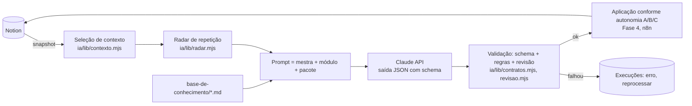

# Arquitetura da inteligência editorial (Fase 3)

## Decisão: um modelo, workflows especializados, código determinístico em volta
Avaliei duas opções:

| | Um modelo + workflows | Multiagente (estrategista, roteirista, revisor… conversando) |
|---|---|---|
| Qualidade | Uma instrução mestra só garante a mesma voz e as mesmas regras em toda saída | Risco de vozes diferentes e de regras aplicadas de forma desigual |
| Confiabilidade | Cada chamada tem entrada e saída com schema; o n8n valida e decide | Mais pontos de falha e estado espalhado |
| Custo | 1 chamada por workflow, com a instrução mestra em cache | 3 a 6 chamadas por tarefa |
| Depuração | Uma Execução = uma chamada, fácil de reprocessar | Difícil saber quem errou |

**Escolha: um modelo com 10 workflows.** Cada workflow é uma chamada à Claude API com:
`instrução mestra` (fixa, em cache) + `módulo do workflow` + `pacote de contexto` (montado por
código) → **JSON validado por schema**.

O que é cálculo, data, status, repetição e permissão é **código** (`ia/lib/*.mjs`), não IA.
A IA interpreta, prioriza, escreve e explica.

## Os 10 workflows
| Workflow | Quando roda | Entrega | Contrato |
|---|---|---|---|
| `estrategia` | Mensal ou sob demanda | Leitura da estratégia, desequilíbrios, propostas B | `contratos/estrategia.schema.json` |
| `planejamento-semanal` | Segunda, 6h30 | Plano da semana (até 4 feeds, stories, captação, reaproveitamento) | `plano-semanal` |
| `direcionamento-diario` | Diário, 6h30, e quando muda a rotina | Orientação para social media e Larissa | `direcionamento-diario` |
| `roteiro` | Sob demanda ("Pedir revisão" ou novo conteúdo) | Rascunho do agente: gancho, roteiro, legenda, CTA, variações | `roteiro` |
| `captacao` | Junto do diário, ou sob demanda | Pedidos de captação com orientação prática | (parte do `direcionamento-diario` e do `plano-semanal`) |
| `pesquisa` | Semanal, com referências enviadas pela equipe | Análise de mecanismo de cada referência | `pesquisa` |
| `revisao` | Antes de toda entrega de texto | Notas por critério, problemas, bloqueios | `revisao` |
| `analise-desempenho` | Semanal | Leitura das métricas e propostas de aprendizado | `analise-desempenho` |
| `aprendizado` | Semanal | Consolida escolhas humanas em aprendizados classificados | `aprendizado` |
| `replanejamento` | Quando um gatilho acontece | Ajustes no plano conforme autonomia | `replanejamento` |

A revisão roda em duas camadas:
1. **Determinística** (`revisao.mjs`): travessões, clichês, "não é sobre X", LA™, "harmonização", HOF em contexto clínico, promessa de resultado, datas e números sem fonte.
2. **Do modelo** (workflow `revisao`): naturalidade, originalidade, interesse e coerência.

Uma saída só vai ao Notion se passar nas duas.

## Modelo, profundidade e custo
- **Modelo:** `claude-opus-5-5` em todos os workflows (padrão do projeto). Trocar algum workflow por `claude-sonnet-5-5` ou `claude-haiku-5-5` é decisão da gestão, depois de comparar na suíte de avaliação.
- **Profundidade (`output_config.effort`):** `high` no planejamento semanal, na estratégia e na análise; `medium` no diário, no roteiro, no replanejamento e no aprendizado; `low` na revisão e na pesquisa.
- **Cache:** instrução mestra + base de conhecimento formam um prefixo estável, com `cache_control` de 1 hora. O pacote de contexto e a data vêm depois do ponto de cache.
- **Recusas:** `fallbacks: "default"` (beta `server-side-fallback-2026-07-01`) ligado por padrão; se a cadeia inteira recusar, a Execução fica com Erro e não se escreve nada.
- **Saída:** `output_config.format = {type: "json_schema", schema}`. Limites de quantidade (até 3 prioridades, até 4 feeds) são conferidos em código, porque o schema da API não garante contagens.

Estimativa de custo em `CUSTOS.md`.

## Ambientes
| Ambiente | Contexto | Escrita |
|---|---|---|
| `teste` (Fase 3) | Pode usar registros com Origem = Simulação e os cenários de `avaliacao/` | Nenhuma no Notion de produção; saídas ficam em arquivo |
| `producao` (Fase 4+) | **Exclui** Origem = Simulação, verificado em código (`contexto.mjs` lança erro se aparecer algum) | Pelo n8n, respeitando `notion/schema/autonomia.json` |

Nenhuma automação recorrente está ativa.
