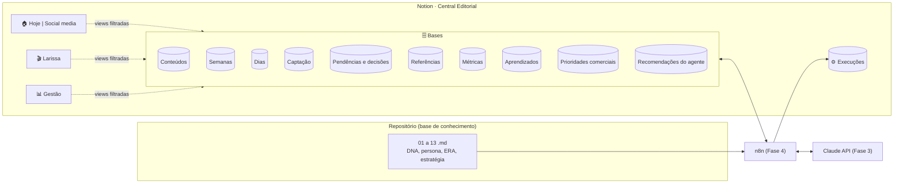

# 01 — Arquitetura da Central Editorial

## Princípio
O Notion é o **lugar de execução** da equipe, não um depósito de estratégia. Cada pessoa abre
uma página só (Hoje, Larissa ou Gestão) e encontra ali o que fazer, por que fazer e como fazer.
A estratégia longa fica na base de conhecimento (`../base-de-conhecimento/`), que o agente lê;
a equipe vê só o resultado dela: intenção da semana, prioridades do dia e orientações de gravação.

## Três camadas, três donos
| Camada | Onde | Quem escreve | Exemplo |
|---|---|---|---|
| Decisão humana | Campos humanos de Conteúdos, Pendências, Prioridades, Captação | Larissa, social media, gestão | Roteiro aprovado, data de publicação, resposta a uma pergunta |
| Proposta da IA | **Recomendações do agente** + campos marcados "Agente" (intenção do dia, orientação de gravação) | Agente via n8n | "Trocar o gancho do CON-12", "Plano da semana W49" |
| Registro técnico | Execuções + campos de sincronização ocultos | n8n | Chave de idempotência, custo, erro, hash |

A IA **nunca** sobrescreve uma decisão humana. Ela propõe, e um humano aceita ou recusa. Detalhes
em `04-Responsabilidades-e-permissoes.md` e `05-Integracao-n8n.md`.

## Por que 11 bases (e não 10 entidades soltas, nem uma base só)
| Entidade pedida | Onde vive | Por quê |
|---|---|---|
| Conteúdos | **Conteúdos** | Fonte única. Ideias, Stories e posts de feed são a mesma coisa em estágios ou formatos diferentes, então são views da mesma base (Banco de ideias = Status Ideia). |
| Planejamentos semanais | **Semanas** | Uma linha por semana, com relação para os conteúdos. "Planejado x publicado" sai de fórmula, sem redigitar. |
| Direcionamentos diários | **Dias** | Uma página por dia. |
| Rotina da Larissa | **Dias** (campo "Minha rotina") | Não ganhou base própria: a rotina só tem sentido junto do dia, e ficar na mesma página deixa lado a lado o que ela contou e o que o agente sugeriu. |
| Demandas de captação | **Captação** | Base própria porque uma sessão de gravação serve a vários conteúdos (muitos para muitos) e tem status, data e local próprios. |
| Pendências e decisões | **Pendências e decisões** | Perguntas P-xx, decisões da gestão e impedimentos têm o mesmo ciclo (aberta, respondida), então ficam juntas e se separam por Tipo. |
| Referências criativas | **Referências** | Catálogo vivo, ligado a vários conteúdos. |
| Métricas | **Métricas** | Várias leituras por conteúdo (D+1, D+7, D+30). Em campos do próprio conteúdo, a série histórica se perderia. |
| Aprendizados | **Aprendizados** | Memória editorial com status próprio (hipótese → validado) e evidências ligadas. |
| Prioridades comerciais | **Prioridades comerciais** | Abrangem várias semanas e vários conteúdos, e a gestão é dona. |
| (novo) | **Recomendações do agente** | Exigência de separar a recomendação da IA da decisão humana. Fica tudo rastreável. |
| (novo, técnico) | **Execuções** | Log, idempotência, custo e reprocessamento. Fica fora da vista da equipe. |

Total: 11 bases, 253 propriedades (a maioria oculta nas views), 6 páginas e 31 views.

## Capacidades da API do Notion — verificado em 2026-11-24
Fontes: documentação oficial ([changelog](https://developers.notion.com/page/changelog),
[create a view](https://developers.notion.com/reference/create-view),
[create a database](https://developers.notion.com/reference/database-create),
[update a data source](https://developers.notion.com/reference/update-a-data-source),
[property object](https://developers.notion.com/reference/property-object),
[working with views](https://developers.notion.com/guides/data-apis/working-with-views),
[webhooks](https://developers.notion.com/reference/webhooks),
[request limits](https://developers.notion.com/reference/request-limits)).
Versão usada: **Notion-Version 2026-03-11** (a mais recente documentada).

| Recurso | API faz? | Como usamos |
|---|---|---|
| Criar base com propriedades | Sim (`POST /v1/databases` com `initial_data_source`) | `setup.mjs`, fase 1 |
| Relação de duas vias | Sim (`dual_property`, devolve `synced_property_id`) | Fase 2. O script renomeia o espelho |
| Fórmula, ID único, criado/editado por | Sim | Fases 1 e 3 |
| Status com opções e grupos | Sim no update (`group`: To-do, In progress, Complete) | Fase 2. **Conferir à mão** se as opções padrão sobraram |
| Views (tabela, quadro, lista, galeria, calendário, formulário, gráfico) | Sim, desde 19/03/2026 (`/v1/views`) | Filtros, ordenação, colunas visíveis e agrupamento pela API |
| View vinculada dentro de uma página comum | Sim (`create_database` com parent page) | Monta as páginas Hoje, Larissa e Gestão |
| Perguntas de formulário | **Não documentado** | Manual |
| Configuração de gráfico | **Não documentado** no create-view | Manual |
| Botão | **Não**: a API ignora `button` em escrita de schema e não pressiona botões | Usamos a caixa "Pedir revisão ao agente" |
| Permissões e compartilhamento de páginas | **Não** | Manual |
| Automações nativas do Notion | **Não** | O n8n faz esse papel |
| Webhooks | Sim: `page.created`, `page.properties_updated` (lote de 1 min), `page.content_updated`, `comment.created` etc. Entrega **no máximo uma vez** (um evento pode se perder), fora de ordem, assinada com HMAC | Gatilho rápido da revisão sob demanda (Fase 4), **sempre com varredura periódica de segurança** para eventos perdidos |
| Limites | 3 req/s por conexão (10 req/s em Business e Enterprise); consulta a data source, ~3 req/s; 2000 caracteres por item de texto; 100 itens por array; 1000 blocos ou 500 KB por payload; até 25 relações avaliadas em fórmula pela API | Cliente com espaçamento de 350 ms e Retry-After. Texto longo vai no corpo da página |

Não verificado (testar no primeiro `--apply`): o formato exato de `group_by` para agrupar por
**opção** de status, e se a lista e a galeria aceitam a configuração de propriedades no
create-view. O script não presume sucesso: qualquer recusa da API vai para a lista de itens
manuais do relatório.
