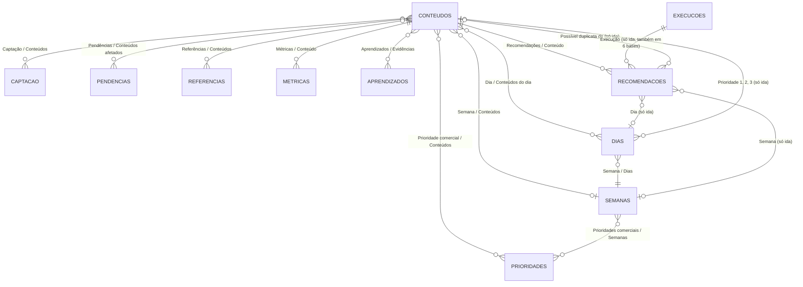
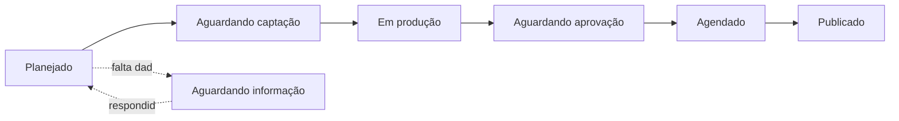

# 02 — Modelo de dados e relacionamentos

Propriedades completas, tipos e opções: **`02b-Propriedades.md`** (gerado do `schema/schema.json`).
Este documento explica as relações, a fonte única de cada informação e o ciclo de vida.

## Relacionamentos

As relações "só ida" evitam encher a base de destino com colunas espelho que ninguém usa. A
Execuções, por exemplo, recebe link de 7 bases e não ganha 7 colunas.

## Fonte única de verdade
| Informação | Fonte única | Nunca duplicar em |
|---|---|---|
| Texto do roteiro, direção criativa, legenda | Corpo da página do Conteúdo | Recomendações (lá fica só a *proposta*) |
| Status e etapa de um conteúdo | Conteúdos.Status (Etapa é fórmula derivada) | Captação, Dias |
| Data de publicação | Conteúdos.Publicação prevista / Publicado em | Semanas (que só agregam) |
| O que é prioridade hoje | Dias.Prioridade 1 a 3 | Campo de prioridade "do dia" no Conteúdo |
| Rotina do dia | Dias.Minha rotina | Qualquer outra base |
| Pergunta e resposta para a Larissa | Pendências e decisões | Documentos .md (que apontam para o código P-xx) |
| Planejado x publicado | Fórmulas em Semanas | Contagem manual |
| Números de desempenho | Métricas | Campos numéricos em Conteúdos |
| Estratégia de longo prazo | `base-de-conhecimento/*.md` | Notion (o Notion mostra só a intenção da semana) |
| Proposta da IA | Recomendações do agente | Campos humanos |

## Identidade, autoria e origem (todas as bases integradas)
| Campo | Para quê |
|---|---|
| **ID** (`CON-12`, `PEN-3`…) | Identificador legível e estável, gerado pelo Notion. Não muda nunca. |
| **Chave** | Chave externa e de idempotência (`trello:C-04`, `pendencia:P-01`, `agente:planejamento-semanal:2026-W49:2`). O n8n procura por ela antes de criar e assim não duplica. |
| **Origem** | Autoria lógica: Trello, Larissa, Social media, Gestão, Agente, Instagram, Sistema. Necessária porque, quando o n8n cria, "Criado por" mostra a integração. |
| **Criado por / em, Atualizado por / em** | Automáticos do Notion. |

## Ciclo de vida dos conteúdos
O Status tem os 11 estados pedidos, agrupados nos três grupos nativos do Notion:

| Grupo | Estados |
|---|---|
| A fazer (To-do) | Ideia · Planejado · Aguardando informação · Aguardando captação |
| Em andamento (In progress) | Em produção · Aguardando aprovação · Aprovado · Agendado |
| Concluído (Complete) | Publicado · Analisado · Arquivado |

**Simplificação para a social media:** a fórmula **Etapa** reduz os 11 estados a 6 palavras,
que aparecem nos cartões: *Ideia, A fazer, Produzindo, Com a Larissa, Pronto, Publicado*.
Ela continua mudando o Status normal, mas no dia a dia só toca em 5 deles:

Os outros estados são marcados por outros papéis: *Ideia* (qualquer pessoa ou o agente),
*Aprovado* (Larissa), *Analisado* (n8n, depois da leitura D+7) e *Arquivado* (gestão).
"Aguardando informação" é o estado **Bloqueado** do plano mestre, sempre acompanhado de
Bloqueio (o motivo) e de pelo menos uma Pendência ligada.

## Corpo das páginas
Textos longos ficam no corpo da página, porque a API limita cada campo de texto a 2000
caracteres. Modelo fixo, com títulos que o n8n reconhece:
- **Conteúdo:** Roteiro · Direção criativa · Legenda · Notas da equipe
- **Dia:** Direcionamento do agente · Stories sugeridos · Captação do dia · Avisos
