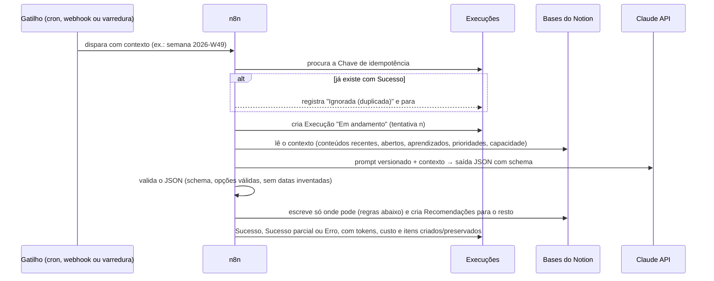

# 05 — Estratégia de integração com n8n e Claude API (preparação para as Fases 3 e 4)

Nada disto está implementado ainda. Este documento define o contrato que a estrutura do Notion
já suporta, para que as Fases 3 e 4 só precisem conectar as peças.

## Fluxo padrão de toda automação

## Regras de escrita (preservação do trabalho humano)
Para cada página que o agente quer alterar:
1. **Travar para o agente** marcado → não escreve, não sugere. Conta em "Itens preservados".
2. Calcula o `hash` atual dos campos de dono "Agente" mais o corpo nas seções do agente. Se for
   diferente do **Hash do agente** salvo → houve edição humana → **Sincronização = Editado pela
   equipe** → não escreve. A mudança vira uma Recomendação.
3. Campo de dono humano → nunca escreve direto (exceção em `04-Responsabilidades-e-permissoes.md`).
   A mudança vira uma Recomendação.
4. Se pode escrever → escreve, incrementa **Versão**, grava novo **Hash do agente**, **Última
   escrita do agente** e **Execução**.
5. Status Aprovado, Agendado, Publicado ou Analisado → o conteúdo está congelado para o agente;
   só Recomendações.

## Identificadores e deduplicação
| Tipo | Chave de idempotência (Execuções) | Chave dos itens criados |
|---|---|---|
| Plano semanal | `planejamento-semanal:2026-W49` | `agente:planejamento-semanal:2026-W49:<n>` |
| Direcionamento diário | `direcionamento-diario:2026-12-01` (rodada após rotina nova: `:r2`) | Dia: `dia:2026-12-01` |
| Processar ideia | `processar-ideia:<page_id da ideia>` | `agente:ideia:<page_id>:<n>` |
| Revisão sob demanda | `revisao:<page_id>:<last_edited_time>` | Recomendação: `rec:<page_id>:<last_edited_time>` |
| Importação | `importacao:trello-2026-11` | `trello:C-xx`, `trello:I-xx`, `pendencia:P-xx` |

**Duplicidade de conteúdo:** antes de criar um Conteúdo novo, o n8n compara o título e o tema
com os conteúdos dos últimos 90 dias e os abertos. Se o agente apontar semelhança alta, em vez
de criar, gera uma Recomendação "Possível duplicidade" ligada ao conteúdo existente
("Possível duplicata de").

## Versionamento
- **Conteúdo:** Versão + Hash do agente + histórico de Recomendações aplicadas. O histórico de
  página do Notion guarda as versões anteriores do texto.
- **Prompts:** cada Execução registra **Versão do prompt** (ex.: `diario@1.2.0`), e os prompts
  ficam versionados no repositório (Fase 3).

## Erros e reprocessamento
- Falha da Claude API, JSON inválido ou erro do Notion → Execução = Erro, com mensagem
  **sanitizada** (sem token, sem dado clínico). Não há escrita parcial sem registro: se metade
  foi escrita, o status é Sucesso parcial, com a contagem.
- Gestão marca **Reprocessar** → varredura de 15 em 15 minutos pega e roda de novo com a mesma
  Chave, tentativa n+1. Graças às chaves e ao hash, o que já foi escrito não duplica.
- 429/529 → respeita Retry-After. Limite de 3 req/s por conexão.

## Controle de custos
- Cada Execução grava tokens de entrada, saída e cache, mais o custo estimado.
- Teto mensal configurável no n8n. Acima de 80% → aviso na página Gestão. Acima de 100% → só as
  rotinas essenciais (direcionamento diário).
- Base de conhecimento enviada com **prompt caching** (é estável), e modelo por tarefa (Fase 3
  define). A estimativa de custo é entregável da Fase 6.

## Gatilhos previstos
| Workflow | Gatilho | Base de entrada |
|---|---|---|
| planejamento-semanal | Seg 6h30 (America/Sao_Paulo) | Semanas, Conteúdos, Prioridades, Aprendizados, Métricas |
| direcionamento-diario | Diário 6h30 + quando "Minha rotina" muda (webhook `page.properties_updated` em Dias) | Dias, Conteúdos, Captação |
| processar-ideia | `page.created` em Conteúdos com Status Ideia e Origem Larissa ou Social media | Conteúdos |
| revisao-sob-demanda | "Pedir revisão ao agente" marcado | Conteúdos |
| pendencias-diarias | Diário | Conteúdos, Pendências |
| revisao-sexta | Sex | Semanas, Conteúdos |
| analise-desempenho | Semanal | Métricas, Conteúdos, Aprendizados |

**Webhooks são só aceleradores.** Como a entrega é "no máximo uma vez", toda automação que
usa webhook tem também uma varredura periódica (a cada 15 minutos) que procura o mesmo
estado (por exemplo, "Pedir revisão ao agente" ainda marcado). A idempotência impede rodar duas
vezes.

## Credenciais
- Notion: conexão interna com acesso só à página "Central Editorial". Token guardado nas
  **credenciais do n8n**, nunca em workflow exportado nem em log.
- Claude API: chave nas credenciais do n8n.
- Os scripts deste repositório leem `notion/.env`, que está no `.gitignore`.

## Fora de escopo (v1)
Publicação automática no Instagram. A API do Instagram fica para a Fase 5, só para ler métricas.
